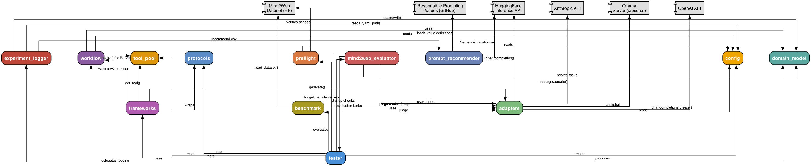
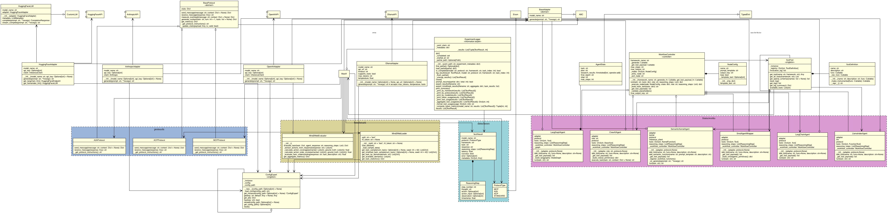

# MASTIF (Multi-Agent System TestIng Framework)

<div align="center">
  
</div>

## Overview

MASTIF is a benchmarking framework for comparing agentic AI stacks across model providers, frameworks, protocols, workflows, and tool ecosystems. It is designed for reproducible evaluations of reasoning, planning, tool use, and web automation on both custom tasks and the [Mind2Web benchmark](https://github.com/OSU-NLP-Group/Mind2Web).

The project supports the same workflow being executed under multiple conditions so you can compare:

- model families and providers
- communication protocols
- framework implementations
- tool availability and prompting strategies
- benchmark vs. custom task performance

## Current key capabilities

MASTIF currently includes the following capabilities, all reflected in the codebase:

- Multi-provider model support for Hugging Face, OpenAI, Anthropic, and local Ollama deployments.
- Multi-framework evaluation across CrewAI, Smolagents, LangChain, LangGraph, LlamaIndex, and Semantic Kernel.
- Protocol comparison for STANDARD, MCP, A2A, and ACP message formats.
- YAML-driven workflow orchestration with node sequencing, looping, output-key propagation, and placeholder validation.
- ReAct-style plain-text tool execution for models that do not expose native structured tool-calling APIs.
- Cross-framework tool pooling where one tool definition is adapted to each framework at runtime.
- Large-scale benchmark support for Mind2Web with judge-based scoring and partial-result resume support.
- Preflight validation for configured models, tokenizers, judge models, and dataset access before a run begins.
- Detailed metrics collection for token usage, latency, reasoning steps, and tool-call statistics.
- JSON result export and CSV conversion utilities for downstream analysis.
- Partial experiment saving so long runs can be resumed without restarting the full benchmark.

## Component and class structure





## Installation

### 1. Create and activate a virtual environment

```bash
python3 -m venv venv
source venv/bin/activate
```

### 2. Install project dependencies

The project includes a pinned dependency set in [requirements.txt](requirements.txt):

```bash
pip install -r requirements.txt
```

For browser-based tooling and web-interaction tasks, install Playwright browsers as well:

```bash
playwright install chromium
```

## Environment variables

Set the credentials required by your selected provider:

```bash
export HF_TOKEN='your_huggingface_token'
export OPENAI_API_KEY='your_openai_key'
export ANTHROPIC_API_KEY='your_anthropic_key'
```

Notes:

- Hugging Face models require `HF_TOKEN`.
- OpenAI models such as `gpt-*` require `OPENAI_API_KEY`.
- Anthropic models such as `claude-*` require `ANTHROPIC_API_KEY`.
- Ollama deployments can be used without a cloud API key when the model is running locally.
- Mind2Web dataset access also requires an accepted Hugging Face token and dataset access.

## Quick start

Copy the example experiment and customize it:

```bash
cp experiments/example.yaml experiments/my-experiment.yaml
python main.py experiments/my-experiment.yaml
```

You can also run the project with the default example config:

```bash
python main.py
```

### Convert JSON results to CSV

```bash
python main.py csv logs/results-<timestamp>.json
```

This writes a sibling CSV next to the original log file.

### Export prompt recommendations to CSV

```bash
python main.py recommend-csv logs/results-<timestamp>.json
```

## Supported model providers and example IDs

MASTIF is not limited to one vendor. The runtime adapters support:

- Hugging Face model IDs such as `meta-llama/Llama-3.3-70B-Instruct`
- OpenAI models such as `gpt-4o`, `gpt-4o-mini`, `gpt-oss-*`
- Anthropic models such as `claude-3-5-sonnet-20241022`
- Ollama models using the local format `llama3.2:latest` or similar local names

Model entries in YAML may be plain strings or dictionaries with an optional tokenizer override:

```yaml
models:
  - id: "gpt-4o"
  - id: "meta-llama/Llama-3.3-70B-Instruct"
  - id: "llama3.2:latest"
  - id: "Qwen/Qwen2.5-7B-Instruct"
    tokenizer: "Qwen/Qwen2.5-7B-Instruct"
```

## Supported frameworks

MASTIF evaluates the same workflow across multiple framework implementations:

- CrewAI
- Smolagents
- LangChain
- LangGraph
- LlamaIndex
- Semantic Kernel

This is implemented through framework-specific wrappers around a shared tool pool and workflow controller.

## Supported protocols

The framework includes protocol-aware prompt wrapping and overhead measurement for:

- `STANDARD`: direct API call without protocol injection
- `MCP`: Model Context Protocol payloads
- `A2A`: Agent-to-Agent message payloads
- `ACP`: Agent Communication Protocol payloads

These are defined in [protocols.py](protocols.py) and are measured for send/receive overhead and message size.

## Workflow configuration

MASTIF executes workflows from YAML. Each workflow node can reference a prompt template, store output in an output key, and optionally loop until the configured step limit is reached.

Example:

```yaml
workflow:
  nodes:
    - name: "plan"
      prompt_template: "prompts/plan.txt"
      output_key: "plan"
      loop: false

    - name: "research"
      prompt_template: "prompts/research.txt"
      output_key: "research_results"
      loop: true

    - name: "report"
      prompt_template: "prompts/report.txt"
      output_key: "final_report"
      loop: false

  entry_node: "plan"
  exit_node: "report"
```

The workflow engine also validates placeholder continuity between nodes and resolves prompt templates relative to the active experiment config file.

## ReAct and plain-text tool execution

MASTIF includes a built-in ReAct parser that can detect and execute tool calls embedded in plain text, even when a model does not support native tool calling.

Example pattern:

```text
Thought: I need to search for the answer.
Action: web_search
Action Input: {"query": "accessibility guidelines"}
Observation: ...
```

The parser extracts the action and argument payload, invokes the registered tool, and appends the observation back into the model context. This helps broaden compatibility with open-source and fine-tuned models.

## Tool pool and built-in tools

The project uses a shared tool registry and adapts the same tool definition to each framework automatically. The built-in tool set includes:

### Core utility and browsing
- `web_search`
- `web_browser`
- `requests_get`
- `beautifulsoup_scraper`
- `web_interaction`
- `keyboard_interaction`
- `searxng_search`

### Knowledge and information retrieval
- `wikipedia`
- `arxiv`
- `pubmed`
- `youtube_transcript`

### Computation and parsing
- `python_repl`
- `sympy`
- `json_parser`
- `pdf_reader`
- `datetime`

This is implemented in [tool_pool.py](tool_pool.py) and supports per-framework conversions for LangChain, CrewAI, Smolagents, LlamaIndex, and Semantic Kernel.

## Configuration reference

The example config in [experiments/example.yaml](experiments/example.yaml) shows the current supported settings:

- `experiment.name`, `experiment.description`
- `temperature`, `max_tokens`, `max_steps`, `max_tool_rounds`, `timeout`
- `workflow.nodes`, `workflow.entry_node`, `workflow.exit_node`
- `test_mode`: `standard` or `mind2web`
- `requests_soft_limit`
- `models`
- `protocols`
- `frameworks`
- `tools`

The same config file powers the runtime, prompt templates, and logger metadata.

## Benchmark modes

### Standard mode

Runs user-defined tasks across all selected models, protocols, and frameworks.

### Mind2Web mode

Runs the [Mind2Web benchmark](https://github.com/OSU-NLP-Group/Mind2Web) and evaluates task completion with a judge model. In this mode, MASTIF validates the dataset and judge availability before execution.

## Output and logs

Results are written to the `logs/` directory.

### Standard mode
- `logs/results-TIMESTAMP.json`
- `logs/intermediate-results-*.json`

### Mind2Web mode
- `logs/mind2web-results-TIMESTAMP.json`
- `logs/results-TIMESTAMP.json`

The logger also supports partial completion tracking and resume prompts so long-running experiments can continue without losing progress.

### Metrics collected

- reasoning steps and thought traces
- total, input, and output token counts
- latency and protocol overhead
- task completion and understanding scores
- tool usage summaries and per-tool statistics
- model/framework/protocol breakdowns

## Preflight validation

Before a run starts, [preflight.py](preflight.py) checks:

- configured model availability
- tokenizer availability or fallback behavior
- required API keys for cloud providers
- Mind2Web dataset access when needed
- judge model validity in benchmark mode

This helps catch configuration problems before a long benchmark run begins.

## Current notes and caveats

- Mind2Web requires a valid Hugging Face token and access to the dataset.
- Browser and web-interaction tools require the Playwright browser runtime.
- Long benchmark runs should be allowed to save partial logs or resumed from previous results.
- Tool execution performance depends on the selected model’s native tool-calling behavior; the ReAct fallback expands compatibility for less capable models.

## Example output

- Standard mode example: [out-standard.txt](out-standard.txt)
- Mind2Web example: [out-mind2web.txt](out-mind2web.txt)

## AI attribution

<a href="https://aiattribution.github.io/statements/AIA-HAb-Ce-Hin-R-?model=Copilot,%20ChatGPT%205.2,%20Gemini%203,%20Sonnet%204.5,%20and%20Sonnet%204.6%20v1.0" target="_blank">AIA Human-AI blend, Content edits, Human-initiated, Reviewed, Copilot, ChatGPT 5.2, Gemini 3, Sonnet 4.5, and Sonnet 4.6 v1.0</a>

More info: https://aiattribution.github.io/